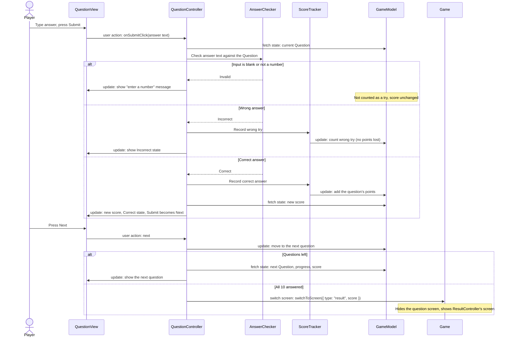
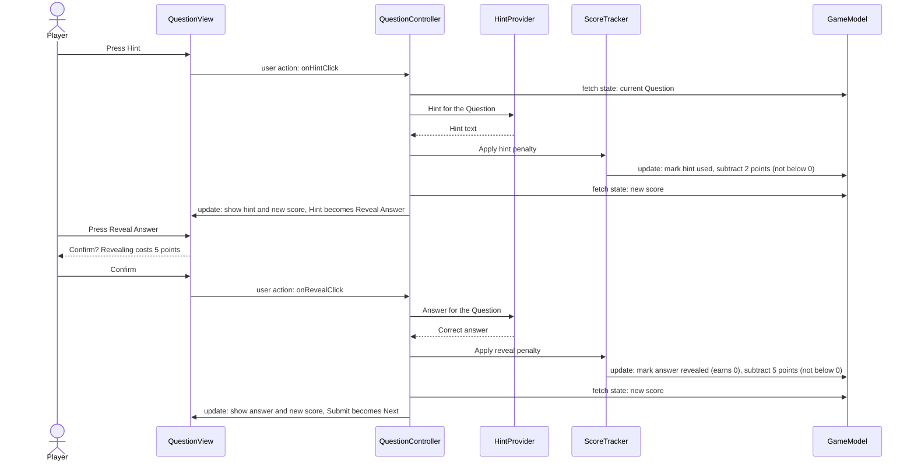

# Architecture

This document collects the architecture of the Percentage Trip Game in one versioned
place: the quality attribute scenarios that drive the design, the dynamic and static
views, a glossary of components, and walkthroughs of the two key scenarios.

**Naming rule:** every component name in this document is the name of a class (or file)
in the code, written exactly the same way in both diagrams and the glossary. Source files
use the class name in camelCase (`MainMenuController` lives in `mainMenuController.ts`);
the exceptions are `GameModel` in `model.ts` and `Game` in `main.ts`. If you rename a
component, update the code, both diagrams, and the [glossary](#4-component-glossary) in
the same pull request.

Contents:

1. [Quality attribute scenarios](#1-quality-attribute-scenarios)
2. [Dynamic view (components and connectors)](#2-dynamic-view-components-and-connectors)
3. [Static view (modules)](#3-static-view-modules)
4. [Component glossary](#4-component-glossary)
5. [Walkthroughs of the key scenarios](#5-walkthroughs-of-the-key-scenarios)

## Overview: Model-View-Controller

The game follows Model-View-Controller (MVC), set up the same way as in lab 4. Both
diagrams use the same parts:

| Part | What it holds | Where |
|---|---|---|
| **View** | One `<Name>View` class per screen. It draws the screen in its own Konva group, shows whatever its controller gives it, and reports clicks through callbacks. It never changes game data. Every view implements the `View` interface. | `src/presentation/` |
| **Controller** | One `<Name>Controller` class per screen. It creates its view (passing the callbacks), updates the Model, gives its view the data to show, and asks `Game` to switch screens. Every controller extends the `Controller` base class. | `src/logic/*Controller.ts` |
| **Model** | `GameModel` (the state of the current trip) and the game rules (questions, answer checking, hints, scoring), plus the backend and its database. | `src/logic/`, `src/data/`, `src/backend/` |
| **Game** | The app entry point. It creates the Konva stage, the `GameModel`, and every controller, and implements `ScreenSwitcher`. | `src/main.ts` |

The shared types (`View`, `Controller`, `Screen`, `ScreenSwitcher`) are in `src/types.ts`.
Controllers and Model logic share `src/logic/`. They are told apart by name: every file
ending in `Controller.ts` is a controller, and no Model module imports a controller.

### Design decisions this document relies on

- **Screens:** main menu (with a pop-up where the player types their name), How to Play
  (`Info`), story choice, question, results, answer key, and the mini-game. There is no
  separate login screen. Story choice and answer key are planned but not built yet.
- **Switching screens:** a controller calls `screenSwitcher.switchToScreen({ type: ... })`.
  `Game` hides every screen and shows the one asked for. Controllers never import each
  other, and `GameModel` doesn't track which screen is showing.
- **Views are passive:** a view never reads or changes the Model. Its controller passes
  it everything it shows (the question, score, messages) and tells it when to redraw.
  Views may import Model *data types* such as `Question` to describe what they're given.
- **Wrong answers:** the player can try again as many times as they like, with no
  penalty. `ScoreTracker` counts wrong tries only for the "wrong answers" stat on the
  results screen.
- **Hints and reveals:** a hint costs 2 points and a reveal costs 5 points, each at most
  once per question, and the score never goes below 0. A revealed question earns no points.
- **Deployment:** the frontend is published to GitHub Pages at
  <https://moonwav.github.io/cse110-group21/>. The **Tests** workflow builds and tests every
  push to `main`; if it passes, its `deploy` job publishes exactly the build it tested. To
  roll back, revert the bad commit on `main`, which redeploys the previous version.

---

## 1. Quality attribute scenarios

Our five priority quality attributes are **modifiability, testability, usability,
conceptual integrity, and deployability**. The game's value comes from its question
content, so we must be able to add and change question types easily (modifiability) and
trust that scoring and answer checking are correct (testability). Our players are middle
schoolers using the game without teacher help (usability). Because a small team builds it
over three sprints, the design must stay consistent (conceptual integrity) and ship
reliably (deployability).

> These are the scenarios from our Q1 submission. The only changes are that component
> names now match the diagrams and the code ("Scoring Engine" → `ScoreTracker`, and so on),
> scenario 2 says "wrong-answer counting" instead of "attempt limits" (there is no limit),
> and scenario 4 describes our MVC structure.

### Scenario 1: Modifiability (adding a new question type)

| Part | Description |
|---|---|
| **Source** | A developer on the team |
| **Stimulus** | Wants to add a new question template (for example "tip calculation") to the game |
| **Artifact** | `QuestionGenerator` and its `QuestionTemplate` definitions |
| **Environment** | Design time; the rest of the game is complete and working |
| **Response** | The developer adds the new template in the shared `QuestionTemplate` format. No changes are needed in any view or controller, `AnswerChecker`, `ScoreTracker`, or `HintProvider`. All existing tests still pass. |
| **Response measure** | Completed in under 3 hours of effort, modifying at most one module plus its test file |

*Why it matters:* our vision includes many question types (discounts, tax, tips, reverse
tax), and we expect to keep adding them.

### Scenario 2: Testability (verifying scoring without the UI)

| Part | Description |
|---|---|
| **Source** | A developer or tester |
| **Stimulus** | Wants to verify the scoring rules: points per question, wrong-answer counting, hint and reveal penalties, and the letter-grade mapping |
| **Artifact** | `ScoreTracker` (and the `GameModel` it updates) |
| **Environment** | Development, using the automated test suite |
| **Response** | `ScoreTracker` runs in isolation. Tests set inputs directly (question value, wrong tries, hints used) and observe outputs (points awarded, final score, grade) without any view, controller, Konva, the network, or the random `QuestionGenerator`. |
| **Response measure** | 100% of scoring rules are covered by automated tests, and the full scoring test suite runs in under 30 seconds |

*Why it matters:* wrong scores would undermine the game's feedback, and scoring logic has
many edge cases (for example, the score must not go below zero).

### Scenario 3: Usability (first-time play without help)

| Part | Description |
|---|---|
| **Source** | A middle school student who has never played the game |
| **Stimulus** | Opens the game and wants to start answering questions |
| **Artifact** | `MainMenuView` (including the name pop-up) and `QuestionView` |
| **Environment** | Normal operation, first use, with no instructions from outside the game |
| **Response** | The student starts a game from the main menu, enters their name, and submits a first answer on the question screen. If the input is invalid (blank or non-numeric), the screen shows an inline message explaining what to fix, and it doesn't count as a try. |
| **Response measure** | At least 90% of test users reach their first submitted answer within 60 seconds with no outside help, and 100% of invalid inputs produce a visible error message |

*Why it matters:* players are students practicing on their own, and confusion about the
interface gets in the way of learning percentages.

### Scenario 4: Conceptual integrity (one consistent design)

| Part | Description |
|---|---|
| **Source** | A developer adding a new feature (for example the matching mini-game) |
| **Stimulus** | Needs to add a new screen and new game logic during Sprint 2 or later |
| **Artifact** | Overall code structure: the MVC split, the shared types in `src/types.ts`, module interfaces, and shared UI pieces |
| **Environment** | Development, mid-project, with multiple developers working in parallel |
| **Response** | The feature follows the existing patterns: the new screen is a `<Name>View` that implements `View` plus a `<Name>Controller` that extends `Controller`, added to the `Screen` type and to `Game`; questions are defined with the shared `QuestionTemplate` format; scoring goes through `ScoreTracker`; views get their data only from their controller; and views use the shared colors in `viewConstants`. The documented patterns are the only approach for each of these jobs. |
| **Response measure** | Code review finds zero deviations from the documented patterns (checked by a reviewer using the [contributing checklist](../CONTRIBUTING.md)), and 0 duplicated copies of shared code such as buttons, colors, or font loading |

*Why it matters:* several teammates build different screens and features, and the game
should feel like one product to players and one design to developers.

### Scenario 5: Deployability (releasing a new version)

| Part | Description |
|---|---|
| **Source** | A developer |
| **Stimulus** | Merges an approved pull request into `main` and wants the new version available to players |
| **Artifact** | Build and deployment pipeline: the GitHub Actions **Tests** workflow (`test` and `deploy` jobs) and GitHub Pages |
| **Environment** | Normal operation, with players possibly using the current version |
| **Response** | Automated tests run on the merge. If they pass, the new version is built and deployed automatically. If they fail, nothing is deployed and the current version stays live. A bad release can be reverted to the previous version. |
| **Response measure** | Deployment completes within 10 minutes of the merge, a failed test run results in 0 deployments, and rollback to the previous version takes under 5 minutes |

*Why it matters:* frequent small releases let us demo working software to the customer
each sprint, and a broken release shouldn't take the game down.

---

## 2. Dynamic view (components and connectors)

The dynamic view shows the running components and how they interact while the game is
played. The diagram source is [`images/cc-view.svg`](images/cc-view.svg); edit that file to
change it.

**Key**

| Symbol | Meaning |
|---|---|
| Box | A component (a running instance of the class of the same name) |
| Dashed box | A planned component that isn't in the code yet |
| Bold box | A group of components: View, Controller, Model |
| Dashed bold box | Components that run on the server instead of in the browser |
| Cylinder | The SQLite database |
| ■ Small black square | An interface (port) where a connector attaches |
| Short-dashed arrow | **User action**: a view reports a click or keypress to its controller through a callback |
| Solid arrow | **Update**: a component tells another to change (a controller updating its view or the Model, `Game` showing or hiding a screen, or `ScoreTracker` updating `GameModel`) |
| Long-dashed arrow | **Fetch state**: a controller reads the current state from the Model, for example the current question or the score |
| Dotted arrow | **Switch screen**: a controller asks `Game`, through `ScreenSwitcher`, to show another screen |
| Thick double-headed arrow | **HTTP request / response** between the browser and the server |
| Dash-dot double-headed arrow | **SQL query / result** between the backend and the database |

How to read it:

- Each view is paired with its own controller. The view sends user actions to the
  controller, and the controller updates the view: the data to show, and states such as
  Submit turning into Next.
- Controllers are the only components that talk to the Model. They read state from it,
  call its rule modules (`QuestionGenerator`, `AnswerChecker`, `HintProvider`,
  `ScoreTracker`, `ApiClient`), and update it. Views never touch the Model.
- `ScoreTracker` is the only rule module that writes to `GameModel` itself. The others take
  a `Question` from the controller and return an answer, which keeps them easy to test.
- To change screens, a controller calls `Game`, which hides every screen and shows the
  requested one.
- The browser reaches the database only through `ApiClient` and HTTP. `Accounts` and
  `ScoreHolder` run on the server and are the only components that query the database.

---

## 3. Static view (modules)

The module view shows the code modules and which modules use which. Every component in the
dynamic view is an instance of a module here with the same name, and the two diagrams use
the same layout. The diagram source is [`images/module-view.svg`](images/module-view.svg);
edit that file to change it.

**Key**

| Symbol | Meaning |
|---|---|
| Box | A module: one class or file, with the same name in the code |
| Dashed box | A planned module that isn't in the code yet |
| Bold box | A layer, with the folder its modules live in |
| Dashed bold box | A layer that runs on the server instead of in the browser |
| Solid arrow A → B | A uses (imports and calls) B. An arrow from a layer means every module in it may use B. |
| Dotted arrow labeled HTTP | A calls B over the network. The only dependency between the browser and the server. |

**What each controller uses**

The diagram draws the controllers' dependencies on the Model as one "uses" arrow. These
are the specific modules behind it. Every controller also uses its own view and
`ScreenSwitcher`.

| Controller | Uses |
|---|---|
| `MainMenuController` | `GameModel` (stores the player's name and starts a trip), `QuestionGenerator` |
| `InfoController` | nothing else |
| `StoryController` | `GameModel` (records the chosen activity) |
| `QuestionController` | `GameModel`, `AnswerChecker`, `HintProvider`, `ScoreTracker` |
| `ResultController` | `GameModel`, `ScoreTracker` (letter grade), `ApiClient` (saves the score) |
| `AnswerKeyController` | `GameModel` |
| `MinigameController` | `MinigameModel` |

**Rules the diagram encodes**

- **Dependencies point downward only:** `Game` → controllers → views and Model, and Model
  logic → data. A view never imports a controller and never calls the Model. The Model
  never imports a view or a controller, even though controllers also live in `src/logic/`.
- **Every screen is a pair:** a `<Name>View` that implements `View` and a
  `<Name>Controller` that extends `Controller`. The controller creates its view and passes
  it callbacks such as `onSubmitClick`; that's how user actions reach the controller
  without the view importing it.
- **Controllers don't import each other.** They depend only on the `ScreenSwitcher`
  interface, which `Game` implements. Adding a screen means adding a case to the `Screen`
  type and to `Game`.
- **Only `ApiClient` talks to the backend, and only over HTTP.** Browser code never imports
  `src/backend/`, because it uses Node-only APIs such as `node:sqlite`.
- **Views share one look.** Colors come from `viewConstants`; no view defines its own.

---

## 4. Component glossary

One line per component. Names match both diagrams and the code exactly. **Status** says
what exists on `main` today.

### App shell (`src/main.ts`, `src/types.ts`)

| Component | Responsibility | Status |
|---|---|---|
| `Game` | Creates the Konva stage, `GameModel`, and every controller, and switches screens. | Exists (`main.ts`); results and mini-game not wired in yet |
| `View` | Interface every view implements: `getGroup()`, `show()`, `hide()`. | Exists (`types.ts`) |
| `Controller` | Base class every controller extends: `getView()`, `show()`, `hide()`. | Exists (`types.ts`) |
| `Screen` | The list of screens `Game` can switch to. | Exists (`types.ts`); needs story and answer key |
| `ScreenSwitcher` | Interface controllers use to change screens; `Game` implements it. | Exists (`types.ts`) |

### View (`src/presentation/`)

| Component | Responsibility | Status |
|---|---|---|
| `MainMenuView` | Start screen with Start Trip, How to Play, and Mini Game, plus the pop-up where the player types their name. | Exists; the typed name isn't passed on yet |
| `InfoView` | How to Play instructions, with a Back button. | Exists |
| `StoryView` | Shows the activity choices (beach, shopping, food, theme park) for the next question. | Planned |
| `QuestionView` | Question screen: progress, score, grade scale, scenario, answer input, Submit/Next, Hint/Reveal, and feedback messages. | In progress (layout only) |
| `ResultView` | Shows the final letter grade, percent score, wrong answers, and hints used, with Answer Key and Play Again. | Empty placeholder |
| `AnswerKeyView` | Lists each question with the player's answers and the correct answer. | Planned |
| `MinigameView` | Matching game screen: two columns to match, a countdown timer, and win and lose overlays. | Empty placeholder |
| `viewConstants` | The game's shared colors. | Exists (colors only) |

### Controller (`src/logic/*Controller.ts`)

| Component | Responsibility | Status |
|---|---|---|
| `MainMenuController` | Opens the name pop-up, stores the name in `GameModel`, starts a trip, and switches to How to Play or the mini-game. | Exists; Start doesn't continue past the pop-up yet |
| `InfoController` | Handles Back to the main menu. | Exists |
| `StoryController` | Records the chosen activity in `GameModel` and moves on to the question. | Planned |
| `QuestionController` | Handles Submit, Next, Hint, and Reveal using `AnswerChecker`, `HintProvider`, and `ScoreTracker`, updates `QuestionView`, and switches to results after question 10. | In progress (handlers are empty) |
| `ResultController` | Shows the final grade from `ScoreTracker`, saves the score through `ApiClient`, and handles Answer Key and Play Again. | Empty placeholder |
| `AnswerKeyController` | Shows the trip's questions and answers from `GameModel`, and handles Back. | Planned |
| `MinigameController` | Runs one matching game in `MinigameModel`: pairs, selections, timer, and win or lose. | Empty placeholder |

### Model: game logic (`src/logic/`)

| Component | Responsibility | Status |
|---|---|---|
| `GameModel` | Everything about the current trip: player name, questions, current position, score, wrong tries, and which hints and reveals were used. | Exists (`model.ts`): player name and score so far |
| `Question` | One generated question: its number, location (scenario), text, correct answer, point value, and hint. | Exists (`question.ts`): no points or hint yet |
| `QuestionGenerator` | Builds a trip's 10 questions (4 easy, 3 medium, 3 hard) from the templates with new random numbers each time. | Planned |
| `AnswerChecker` | Validates the player's input and decides whether it matches a `Question`'s correct answer. | Planned |
| `HintProvider` | Gives the hint text and the revealed answer for a `Question`. Penalties are applied by `ScoreTracker`, not here. | Planned |
| `ScoreTracker` | Applies all scoring rules to `GameModel`: points per question, hint and reveal penalties, the floor at zero, wrong-try counting, and the letter grade. | Planned |
| `MinigameModel` | Everything about the current matching game: the pairs, current selection, matches made, and time left. | Planned |
| `ApiClient` | The browser's only connection to the backend: sends the player and finished-trip score over HTTP. | Planned |

### Model: data (`src/data/`)

| Component | Responsibility | Status |
|---|---|---|
| `QuestionTemplate` | The type and list of question templates: scenario, prompt, difficulty, number ranges, formula, points, and hint. | Exists (`questionTemplates.ts`, ten templates) |

### Model: backend (`src/backend/`, runs on the server)

| Component | Responsibility | Status |
|---|---|---|
| `ApiRouter` | HTTP endpoints that receive requests from `ApiClient` and pass them to `Accounts` or `ScoreHolder`. | Planned |
| `Accounts` | Creates and looks up players (name and unique ID). | Planned |
| `ScoreHolder` | Saves and reads players' finished-trip scores. | Planned |
| `Database` | Opens the SQLite database and creates its tables. | Exists as `src/data/database.ts`; should move here |

---

## 5. Walkthroughs of the key scenarios

These walkthroughs trace two scenarios through the components above, using the connector
types from the dynamic view. They show which component does each job and how the design
supports the quality attributes in section 1.

### 5.1 Answering a question

A player types an answer on the question screen and presses **Submit**.

Step by step:

1. **`QuestionView`** passes the text in the answer box to its controller through the
   `onSubmitClick` callback. The view does no math and no checking.
2. **`QuestionController`** gets the current `Question` from **`GameModel`** and asks
   **`AnswerChecker`** whether the text matches its correct answer.
3. If the input is blank or not a number, `AnswerChecker` reports it as invalid. The
   controller tells the view to show an inline message, and **it doesn't count as a try**
   (scenario 3, usability).
4. If the answer is wrong, **`ScoreTracker`** counts the wrong try in `GameModel` (for the
   results stats; no points are lost), and the controller shows the Incorrect state so the
   player can try again as many times as they like.
5. If the answer is right, `ScoreTracker` adds the question's points to `GameModel`. The
   controller reads the new score and gives it to the view, along with the Correct state;
   Submit becomes Next.
6. **Next** moves `GameModel` to the following question, and the controller gives the view
   the new question. After question 10, the controller calls `Game` through
   `ScreenSwitcher` to show the results screen.

How the design supports the quality attributes:

- **Testability (scenario 2):** `AnswerChecker` and `ScoreTracker` don't depend on any
  view, controller, Konva, network call, or random numbers. Tests create a `GameModel` and
  a fixed `Question`, call them, and check the result.
- **Conceptual integrity (scenario 4):** each job has exactly one home: checking in
  `AnswerChecker`, scoring in `ScoreTracker`, state in `GameModel`, screen changes in the
  controller and `Game`. The view only displays what it's given.
- **Modifiability (scenario 1):** `AnswerChecker` compares against the `Question`'s stored
  answer, so a new question type needs no changes here.

### 5.2 Using a hint, then revealing the answer

A player is stuck, presses **Hint**, and later presses **Reveal Answer**.

Step by step:

1. **Hint:** `QuestionController` gets the current `Question` from `GameModel`, asks
   **`HintProvider`** for its hint, and tells **`ScoreTracker`** to apply the hint penalty.
2. `ScoreTracker` marks the hint as used for this question in **`GameModel`** and subtracts
   the penalty, never letting the score go below zero.
3. The controller gives `QuestionView` the hint and the new score, and the Hint button
   becomes **Reveal Answer**.
4. **Reveal:** the confirmation dialog belongs to `QuestionView` alone, so cancelling
   changes nothing. On confirm, the controller gets the answer from `HintProvider`, and
   `ScoreTracker` applies the reveal penalty.
5. The question is marked as revealed in `GameModel` and earns no points. The mark also
   lets it show correctly on the results screen (hints used) and the answer key. Submit
   becomes Next.
6. **Penalties apply once per question.** If the player presses Hint or Reveal again, or
   the event fires twice, `ScoreTracker` sees the mark in `GameModel` and does not subtract
   again.

How the design supports the quality attributes:

- **Testability (scenario 2):** the "once per question" and "not below zero" rules live in
  `ScoreTracker` and are tested without the UI by calling it twice and checking the score.
- **Modifiability (scenario 1):** hint text comes from the `Question` (and its
  `QuestionTemplate`), so a new question type brings its own hint without changes to
  `HintProvider`.
- **Separation of concerns:** `HintProvider` only provides content and `ScoreTracker` only
  scores, so changing a penalty amount touches one module.
