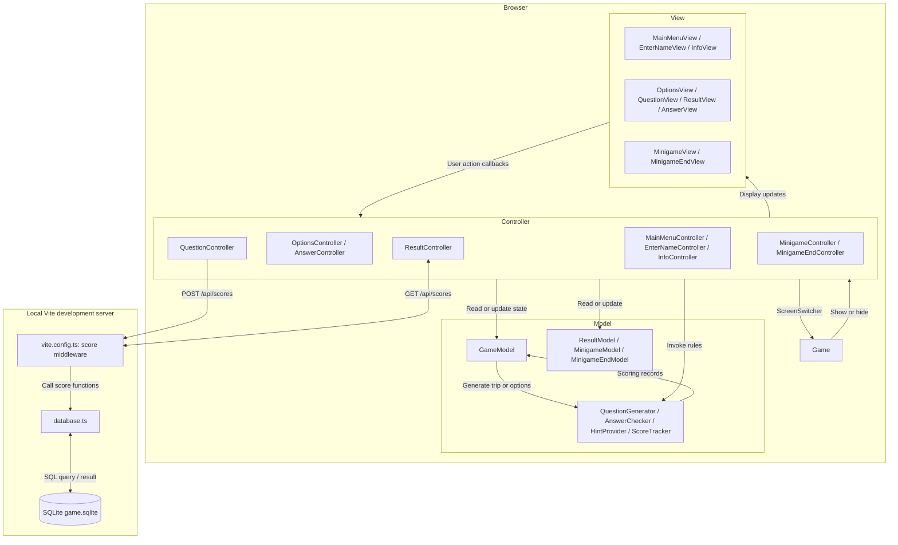
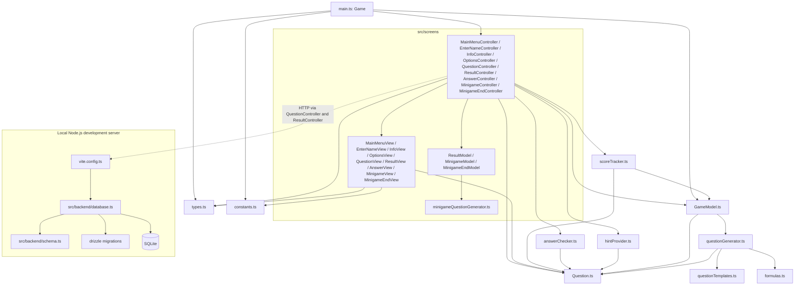
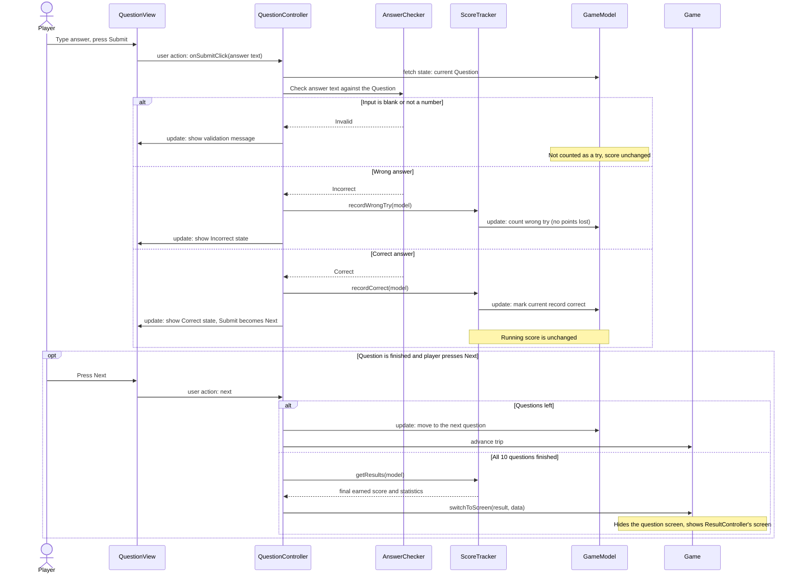
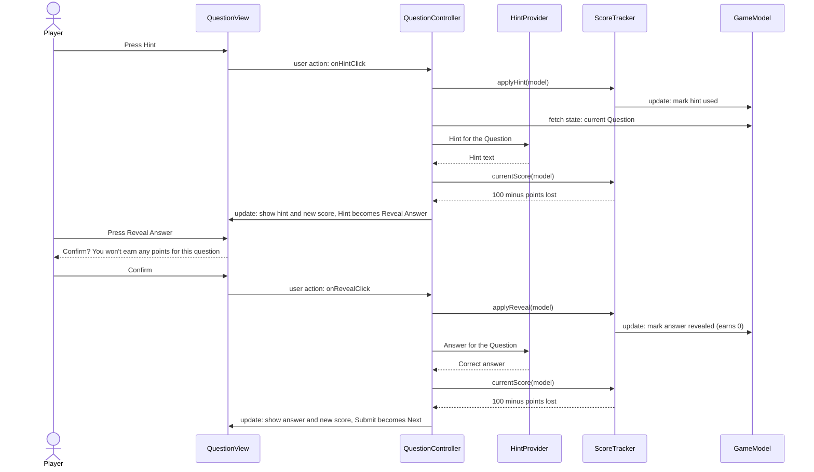

# Architecture

This document collects the architecture of the Percentage Trip Game in one versioned
place: the quality attribute scenarios that drive the design, the dynamic and static
views, a glossary of components, and walkthroughs of the two key scenarios.

**Naming rule:** component names refer to the classes or modules in the code.
A class normally lives in a file with the same name in PascalCase (`MainMenuController`
lives in `MainMenuController.ts`). A module that exports only functions or data lives in a
camelCase file (`ScoreTracker` is `scoreTracker.ts`, `QuestionTemplate` is in
`questionTemplates.ts`). `Game` lives in `main.ts`, the app's entry point. The answer
key exports `AnswerController` and `AnswerView` from `AnswerKeyController.ts` and
`AnswerKeyView.ts`, respectively. If you rename a component, update the code, both
diagrams, and the [glossary](#4-component-glossary) in the same pull request.

Contents:

1. [Quality attribute scenarios](#1-quality-attribute-scenarios)
2. [Dynamic view (components and connectors)](#2-dynamic-view-components-and-connectors)
3. [Static view (modules)](#3-static-view-modules)
4. [Component glossary](#4-component-glossary)
5. [Walkthroughs of the key scenarios](#5-walkthroughs-of-the-key-scenarios)

## Overview: Model-View-Controller

The game follows Model-View-Controller (MVC), set up the same way as in lab 4. Both
diagrams use the same parts:

| Part | What it holds | Where |
|---|---|---|
| **View** | One `<Name>View` class per screen. It draws the screen in its own Konva group, shows whatever its controller gives it, and reports clicks through callbacks. It never changes game data. Every view implements the `View` interface. | `src/screens/<Screen>/<Screen>View.ts` |
| **Controller** | One `<Name>Controller` class per screen. It creates its view (passing the callbacks), updates the Model, gives its view the data to show, and asks `Game` to switch screens. Every controller extends the `Controller` base class. | `src/screens/<Screen>/<Screen>Controller.ts` |
| **Model** | `GameModel` (the state of the current trip) and the game rules (questions, answer checking, hints, scoring), plus the backend and its database. A model that only one screen uses lives with that screen. | `src/model/`, `src/screens/<Screen>/<Screen>Model.ts`, `src/backend/` |
| **Game** | The app entry point. It creates the Konva stage, the `GameModel`, and every controller, and implements `ScreenSwitcher`. | `src/main.ts` |

The shared types (`View`, `Controller`, `Screen`, `ScreenSwitcher`) are in `src/types.ts`,
and the shared colors and fonts are in `src/constants.ts`. Each screen has its own folder
under `src/screens/` holding its view, its controller, and any model only that screen
uses (`MinigameModel`, `ResultModel`, `MinigameEndModel`). The minigame end screen only
ever opens from the mini-game, so its folder is inside the mini-game's
(`src/screens/Minigame/MinigameEnd/`). Shared Model code is in `src/model/`. Code outside
a screen's folder may import *types* from it (for example `ResultData`), but never its
view or controller.

### Design decisions this document relies on

- **Screens:** main menu (with a pop-up where the player types their name, managed by
  `EnterNameController` and `EnterNameView`), How to Play (`Info`), story choice (`Options`),
  question, results, answer key, the mini-game, and the minigame end screen. All are implemented.
  There is no separate login screen.
- **Minigame end screen:** when a round ends, the result (completed in time or ran out of
  time) is its own screen, not part of `MinigameView`. It is a pop-up drawn over the
  darkened mini-game: for `"minigame end"`, `Game` shows the mini-game's *view* without
  calling `MinigameController.show()` (that would start a new round), then shows the
  end screen on top.
- **Switching screens:** a controller calls `screenSwitcher.switchToScreen({ type: ... })`.
  `Game` hides every screen and shows the one asked for. Controllers never import each
  other, and `GameModel` doesn't track which screen is showing.
- **Views are passive:** a view never reads or changes the Model. Its controller passes
  it everything it shows (the question, score, messages) and tells it when to redraw.
  Views may import Model *data types* such as `Question` to describe what they're given.
- **Wrong answers:** the player can try again as many times as they like, with no
  penalty. `ScoreTracker` counts wrong tries only for the "wrong answers" stat on the
  results screen.
- **Hints and reveals:** a hint costs 2 points, at most once per question. Reveal is only
  available after a hint; a revealed question earns no points, so it loses its full value
  (7, 10 or 14, with the hint's 2 already included).
- **Deployment:** the frontend is published to GitHub Pages at
  <https://moonwav.github.io/cse110-group21/>. The **Tests** workflow builds and tests every
  push to `main`; if it passes, its `deploy` job publishes exactly the build it tested. To
  roll back, revert the bad commit on `main`, which redeploys the previous version.

---

## 1. Quality attribute scenarios

Our five priority quality attributes are **modifiability, testability, usability,
conceptual integrity, and deployability**. The game's value comes from its question
content, so we must be able to add and change question types easily (modifiability) and
trust that scoring and answer checking are correct (testability). Our players are middle
schoolers using the game without teacher help (usability). Because a small team builds it
over three sprints, the design must stay consistent (conceptual integrity) and ship
reliably (deployability).

> These are the scenarios from our Q1 submission. The only changes are that component
> names now match the diagrams and the code ("Scoring Engine" → `ScoreTracker`, and so on),
> scenario 2 says "wrong-answer counting" instead of "attempt limits" (there is no limit),
> and scenario 4 describes our MVC structure.

### Scenario 1: Modifiability (adding a new question type)

| Part | Description |
|---|---|
| **Source** | A developer on the team |
| **Stimulus** | Wants to add a new question template (for example "tip calculation") to the game |
| **Artifact** | `QuestionGenerator` and its `QuestionTemplate` definitions |
| **Environment** | Design time; the rest of the game is complete and working |
| **Response** | The developer adds the new template in the shared `QuestionTemplate` format. No changes are needed in any view or controller, `AnswerChecker`, `ScoreTracker`, or `HintProvider`. All existing tests still pass. |
| **Response measure** | Completed in under 3 hours of effort, modifying at most one module plus its test file |

*Why it matters:* our vision includes many question types (discounts, tax, tips, reverse
tax), and we expect to keep adding them.

### Scenario 2: Testability (verifying scoring without the UI)

| Part | Description |
|---|---|
| **Source** | A developer or tester |
| **Stimulus** | Wants to verify the scoring rules: points per question, wrong-answer counting, hint and reveal penalties, and the letter-grade mapping |
| **Artifact** | `ScoreTracker` (and the `GameModel` it updates), `ResultModel` for letter grades |
| **Environment** | Development, using the automated test suite |
| **Response** | `ScoreTracker` runs in isolation. Tests set inputs directly (question value, wrong tries, hints used) and observe outputs (points awarded and final score). Letter grades are tested through `ResultModel`. Neither requires any view, controller, Konva, the network, or the random `QuestionGenerator`. |
| **Response measure** | 100% of scoring rules are covered by automated tests, and the full scoring test suite runs in under 30 seconds |

*Why it matters:* wrong scores would undermine the game's feedback, and scoring logic has
many edge cases (for example, the score must not go below zero).

### Scenario 3: Usability (first-time play without help)

| Part | Description |
|---|---|
| **Source** | A middle school student who has never played the game |
| **Stimulus** | Opens the game and wants to start answering questions |
| **Artifact** | `MainMenuView` (including the name pop-up) and `QuestionView` |
| **Environment** | Normal operation, first use, with no instructions from outside the game |
| **Response** | The student starts a game from the main menu, enters their name, and submits a first answer on the question screen. If the input is invalid (blank or non-numeric), the screen shows an inline message explaining what to fix, and it doesn't count as a try. |
| **Response measure** | At least 90% of test users reach their first submitted answer within 60 seconds with no outside help, and 100% of invalid inputs produce a visible error message |

*Why it matters:* players are students practicing on their own, and confusion about the
interface gets in the way of learning percentages.

### Scenario 4: Conceptual integrity (one consistent design)

| Part | Description |
|---|---|
| **Source** | A developer adding a new feature (for example the matching mini-game) |
| **Stimulus** | Needs to add a new screen and new game logic during Sprint 2 or later |
| **Artifact** | Overall code structure: the MVC split, the shared types in `src/types.ts`, module interfaces, and shared UI pieces |
| **Environment** | Development, mid-project, with multiple developers working in parallel |
| **Response** | The feature follows the existing patterns: the new screen is a folder `src/screens/<Name>/` with a `<Name>View` that implements `View` plus a `<Name>Controller` that extends `Controller`, added to the `Screen` type and to `Game`; questions are defined with the shared `QuestionTemplate` format; scoring goes through `ScoreTracker`; views get their data only from their controller; and views use the shared colors in `constants`. The documented patterns are the only approach for each of these jobs. |
| **Response measure** | Code review finds zero deviations from the documented patterns (checked by a reviewer using the [contributing checklist](../CONTRIBUTING.md)), and 0 duplicated copies of shared code such as buttons, colors, or font loading |

*Why it matters:* several teammates build different screens and features, and the game
should feel like one product to players and one design to developers.

### Scenario 5: Deployability (releasing a new version)

| Part | Description |
|---|---|
| **Source** | A developer |
| **Stimulus** | Merges an approved pull request into `main` and wants the new version available to players |
| **Artifact** | Build and deployment pipeline: the GitHub Actions **Tests** workflow (`test` and `deploy` jobs) and GitHub Pages |
| **Environment** | Normal operation, with players possibly using the current version |
| **Response** | Automated tests run on the merge. If they pass, the new version is built and deployed automatically. If they fail, nothing is deployed and the current version stays live. A bad release can be reverted to the previous version. |
| **Response measure** | Deployment completes within 10 minutes of the merge, a failed test run results in 0 deployments, and rollback to the previous version takes under 5 minutes |

*Why it matters:* frequent small releases let us demo working software to the customer
each sprint, and a broken release shouldn't take the game down.

---

## 2. Dynamic view (components and connectors)

The dynamic view shows the running components and how they interact while the game is
played. The diagram is embedded below so it can be updated directly in this document.
The grouped connectors summarize interactions of the relevant screens.

**Key**

| Symbol | Meaning |
|---|---|
| Box | A running component or group of related components |
| Group | A layer or runtime boundary |
| Cylinder | The SQLite database |
| Labeled arrow | User action, update, state access, rule invocation, screen switch, HTTP request or SQL interaction, as labeled |

How to read it:

- Each view is paired with its own controller. The view sends user actions to the
  controller, and the controller updates the view: the data to show, and states such as
  Submit turning into Next.
- Controllers read state from the Model, call its rule modules (`QuestionGenerator`,
  `AnswerChecker`, `HintProvider`, `ScoreTracker`), and update it.
- `ScoreTracker` is the only shared rule module that writes to `GameModel` itself.
- To change screens, a controller calls `Game`, which hides every screen and shows the
  requested one.
- `QuestionController` sends completed results with `POST /api/scores`;
  `ResultController` retrieves the player's top scores with `GET /api/scores?name=...`.
  Both call `fetch()` directly. The middleware in `vite.config.ts` calls the functions
  in `src/backend/database.ts`, which access SQLite through Drizzle ORM.
- The score API is available when running the local Vite development server. GitHub
  Pages hosts the static frontend only; the trip remains playable without score persistence,
  and the leaderboard is empty when the score API is unavailable.

---

## 3. Static view (modules)

The module view shows the code modules and which modules use which. The diagram is
embedded below. Grouped arrows summarize dependencies of relevant members rather than
implying that every member imports every target.

**Key**

| Symbol | Meaning |
|---|---|
| Box | A module or group of related modules |
| Group | A layer or runtime boundary |
| Solid arrow A → B | A uses B (imports, calls, or accesses data/infrastructure) |
| Dotted arrow labeled HTTP | A calls B over the network, not a source-code import |

**What each controller uses**

The diagram draws the controllers' dependencies on the Model as grouped arrows. These
are the specific modules behind them. Every controller also uses its own view and
`ScreenSwitcher`.

| Controller | Uses |
|---|---|
| `MainMenuController` | Navigates to name entry, instructions or mini-game |
| `EnterNameController` | `GameModel` (stores the player's name and starts a trip) |
| `InfoController` | Navigation back to the main menu |
| `OptionsController` | `GameModel` (selects the next activity and question) |
| `QuestionController` | `GameModel`, `Question`, `AnswerChecker`, `HintProvider`, `ScoreTracker`, `fetch()` (POST completed results) |
| `ResultController` | `GameModel`, `ResultModel` (letter grade), `fetch()` (GET score history) |
| `AnswerController` | `GameModel` |
| `MinigameController` | `MinigameModel`, `constants` |
| `MinigameEndController` | `MinigameEndModel` (the end screen's title and message) |

**Rules the diagram encodes**

- **Dependencies point downward only:** `Game` → controllers → views and Model, and Model
  logic → data. A view never imports a controller and never calls the Model. The Model
  never imports a view or a controller.
- **Every screen is a pair:** a `<Name>View` that implements `View` and a
  `<Name>Controller` that extends `Controller`, both in `src/screens/<Name>/`. The
  controller creates its view and passes
  it callbacks such as `onSubmitClick`; that's how user actions reach the controller
  without the view importing it.
- **Controllers don't import each other.** They depend only on the `ScreenSwitcher`
  interface, which `Game` implements. Adding a screen means adding a case to the `Screen`
  type and to `Game`.
- **The browser talks to the backend only over HTTP.** `QuestionController` and
  `ResultController` use `fetch()` directly. Browser code never imports `src/backend/`,
  because it uses Node-only APIs such as `node:sqlite`.
- **Views share one look.** Colors come from `constants`; no view defines its own.

---

## 4. Component glossary

One line per component. **Status** says what exists on `main` today.

### App shell (`src/main.ts`, `src/types.ts`)

| Component | Responsibility | Status |
|---|---|---|
| `Game` | Creates the Konva stage, `GameModel`, and every controller, and switches screens. | Exists (`main.ts`) |
| `View` | Interface every view implements: `getGroup()`, `show()`, `hide()`. | Exists (`types.ts`) |
| `Controller` | Base class every controller extends: `getView()`, `show()`, `hide()`. | Exists (`types.ts`) |
| `Screen` | The list of screens `Game` can switch to, including options and answer key. | Exists (`types.ts`) |
| `ScreenSwitcher` | Interface controllers use to change screens; `Game` implements it. | Exists (`types.ts`) |

### View (`src/screens/<Screen>/<Screen>View.ts`)

| Component | Responsibility | Status |
|---|---|---|
| `MainMenuView` | Start screen with Start Trip, How to Play, and Mini Game. | Exists |
| `EnterNameView` | Name entry pop-up and welcome message. | Exists |
| `InfoView` | How to Play instructions, with a Back button. | Exists |
| `OptionsView` | Shows up to four remaining activity choices for the next question. | Exists |
| `QuestionView` | Question screen: progress, score, grade scale, scenario, answer input, Submit/Next, Hint/Reveal, and feedback messages. | Exists |
| `ResultView` | Shows the final letter grade, percent score, wrong answers, hints used, leaderboard, Answer Key and Play Again. | Exists |
| `AnswerView` | Displays the trip's questions and correct answers with navigation controls. | Exists (`AnswerKeyView.ts`) |
| `MinigameView` | Matching game screen: two columns to match, a countdown timer, and green and red cards for right and wrong pairs. | Exists |
| `MinigameEndView` | Pop-up over the darkened mini-game: a title and message (given by its controller), with Play Again and Main Menu. The dark background blocks clicks on the cards underneath. | Exists (`src/screens/Minigame/MinigameEnd/`) |
| `constants` | The game's shared colors and fonts. | Exists (`src/constants.ts`) |

### Controller (`src/screens/<Screen>/<Screen>Controller.ts`)

| Component | Responsibility | Status |
|---|---|---|
| `MainMenuController` | Opens the name pop-up and switches to How to Play or the mini-game. | Exists |
| `EnterNameController` | Validates the name, stores it in `GameModel`, starts the trip, and opens the options screen. | Exists |
| `InfoController` | Handles Back to the main menu. | Exists |
| `OptionsController` | Displays choices, records the chosen activity in `GameModel`, and moves on to the question. | Exists |
| `QuestionController` | Handles Submit, Next, Hint, and Reveal using `AnswerChecker`, `HintProvider`, and `ScoreTracker`; updates `QuestionView`; posts completed results and switches to results after question 10. | Exists |
| `ResultController` | Displays the grade from `ResultModel`, retrieves score history through HTTP, and handles Answer Key and Play Again. | Exists |
| `AnswerController` | Shows the trip's questions and correct answers from `GameModel`, and handles navigation and Back. | Exists (`AnswerKeyController.ts`) |
| `MinigameController` | Runs one matching game: tracks the selected question and answer, checks each submitted pair against `MinigameModel`, runs the 60-second timer, and ends the round on a win or when time runs out by switching to the minigame end screen with whether it was completed and the time taken. | Exists |
| `MinigameEndController` | Stores the round's result in `MinigameEndModel`, gives `MinigameEndView` the title and message to show, and handles Play Again (a new round) and Main Menu. | Exists (`src/screens/Minigame/MinigameEnd/`) |

### Model: game logic (`src/model/`)

| Component | Responsibility | Status |
|---|---|---|
| `GameModel` | Stores the current trip's player name, questions, current position, latest answer, and records of correct answers, wrong tries, hints and reveals. | Exists (`GameModel.ts`) |
| `Question` | One generated question: its number, location (scenario), text, correct answer, point value, hint, and picture. | Exists (`Question.ts`) |
| `QuestionGenerator` | Builds a trip's 10 questions (4 easy, 3 medium, 3 hard) from templates with new random numbers each time and selects available activity options. | Exists (`questionGenerator.ts`) |
| `AnswerChecker` | Validates the player's input and decides whether it matches a `Question`'s correct answer. | Exists (`answerChecker.ts`) |
| `HintProvider` | Gives the hint text and the revealed answer for a `Question`. Penalties are applied by `ScoreTracker`, not here. | Exists (`hintProvider.ts`) |
| `ScoreTracker` | Records correct answers, wrong tries, hints and reveals; derives the running score, final earned points and result statistics from question records. | Exists (`scoreTracker.ts`) |
| `ResultModel` | Stores final results and maps the numeric score to a letter grade and feedback message. | Exists (`Result/ResultModel.ts`) |
| `MinigameModel` | The current matching game's shuffled questions and answers and the correct pairs made so far. | Exists (`MinigameModel.ts`) |
| `MinigameEndModel` | The finished round's result (`MinigameEndData`: completed or not, and seconds taken) and the end screen's text: "Congratulations!" plus the time, or "You ran out of time". | Exists (`MinigameEnd/MinigameEndModel.ts`) |

`ResultModel`, `MinigameModel`, and `MinigameEndModel` are screen-specific models and
live with their screens under `src/screens/` instead of in `src/model/`.

### Model: data (`src/model/`)

| Component | Responsibility | Status |
|---|---|---|
| `QuestionTemplate` | The type and list of question templates: scenario, prompt, difficulty, number ranges, formula, points, and hint. | Exists (`questionTemplates.ts`, ten templates) |
| `formulas` | Mathematical functions used by generated questions. | Exists (`formulas.ts`) |
| `minigameQuestionGenerator` | Generates problems and answers for the matching game. | Exists (`src/screens/Minigame/minigameQuestionGenerator.ts`) |

### Model: backend (local development server)

| Component | Responsibility | Status |
|---|---|---|
| `vite.config.ts` | Registers the development server's GET and POST `/api/scores` middleware. | Exists |
| `database.ts` | Opens and migrates SQLite, finds or creates players, saves completed games and retrieves score history. | Exists (`src/backend/database.ts`) |
| `schema.ts` | Defines the `players` and `scores` tables and their relationship. | Exists (`src/backend/schema.ts`) |
| `drizzle/` | Versioned database migrations. | Exists |
| SQLite | Persists player and score data in the local `game.sqlite` file. | Available locally |

---

## 5. Walkthroughs of the key scenarios

These walkthroughs trace two scenarios through the components above, using the connector
types from the dynamic view. They show which component does each job and how the design
supports the quality attributes in section 1.

### 5.1 Answering a question

A player types an answer on the question screen and presses **Submit**.

Step by step:

1. **`QuestionView`** passes the text in the answer box to its controller through the
   `onSubmitClick` callback. The view does no math and no checking.
2. **`QuestionController`** gets the current `Question` from **`GameModel`** and asks
   **`AnswerChecker`** whether the text matches its correct answer.
3. If the input is blank or not a number, `AnswerChecker` reports it as invalid. The
   controller tells the view to show an inline message, and **it doesn't count as a try**
   (scenario 3, usability).
4. If the answer is wrong, **`ScoreTracker`** counts the wrong try in `GameModel` (for the
   results stats; no points are lost), and the controller shows the Incorrect state so the
   player can try again as many times as they like.
5. If the answer is right, `ScoreTracker.recordCorrect()` marks the question's record as
   correct. The displayed score starts at 100 and is calculated by `currentScore()` as
   100 minus points lost to hints and reveals. A correct answer does not increase the
   displayed score. The controller shows the Correct state; Submit becomes Next.
6. **Next** advances the trip. After question 10, `ScoreTracker.getResults()` calculates
   the final score as the sum of points earned on correctly answered questions after
   penalties, along with wrong-answer and hint statistics. `QuestionController` posts
   the result to the local score API on a best-effort basis and calls `Game` through
   `ScreenSwitcher` to show the results screen. `ResultModel` determines the letter grade.

How the design supports the quality attributes:

- **Testability (scenario 2):** `AnswerChecker` and `ScoreTracker` don't depend on any
  view, controller, Konva, network call, or random numbers. Tests create a `GameModel` and
  a fixed `Question`, call them, and check the result.
- **Conceptual integrity (scenario 4):** each job has exactly one home: checking in
  `AnswerChecker`, scoring in `ScoreTracker`, state in `GameModel`, screen changes in the
  controller and `Game`. The view only displays what it's given.
- **Modifiability (scenario 1):** `AnswerChecker` compares against the `Question`'s stored
  answer, so a new question type needs no changes here.

### 5.2 Using a hint, then revealing the answer

A player is stuck, presses **Hint**, and later presses **Reveal Answer**.

Step by step:

1. **Hint:** `QuestionController` tells **`ScoreTracker`** to apply the hint penalty,
   gets the current `Question` from `GameModel`, and asks **`HintProvider`** for its hint.
2. `ScoreTracker` marks the hint as used for this question in **`GameModel`**. The running
   score is derived from the records using `currentScore()`; a hint reduces it by 2 points.
3. The controller gives `QuestionView` the hint and the new score, and the Hint button
   becomes **Reveal Answer**.
4. **Reveal:** the confirmation dialog belongs to `QuestionView` alone, so cancelling
   changes nothing. On confirm, the controller calls `ScoreTracker.applyReveal()` and
   gets the answer from `HintProvider`.
5. The question is marked as revealed in `GameModel` and earns no points. The running
   score loses the full question value, including the 2 points already lost for the hint.
   The question still counts toward hints used. Submit becomes Next.
6. **Penalties apply once per question.** If the player presses Hint or Reveal again, or
   the event fires twice, `ScoreTracker` sees the mark in `GameModel` and does not deduct
   points again. The score is derived rather than stored as a mutable total.

How the design supports the quality attributes:

- **Testability (scenario 2):** the "once per question" and "not below zero" rules live in
  `ScoreTracker` and are tested without the UI by calling it twice and checking the score.
- **Modifiability (scenario 1):** hint text comes from the `Question` (and its
  `QuestionTemplate`), so a new question type brings its own hint without changes to
  `HintProvider`.
- **Separation of concerns:** `HintProvider` only provides content and `ScoreTracker` only
  scores, so changing a penalty amount touches one module.
