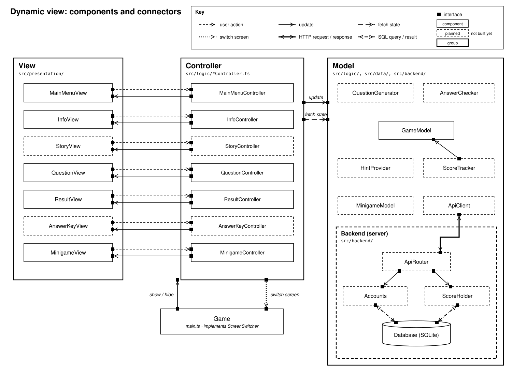
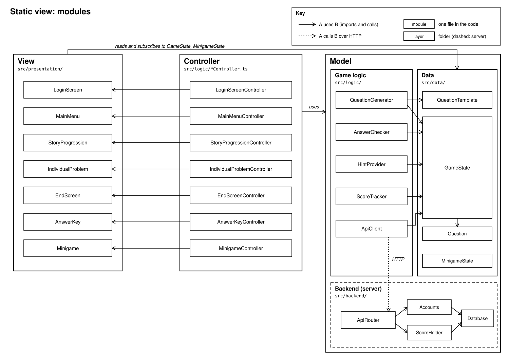
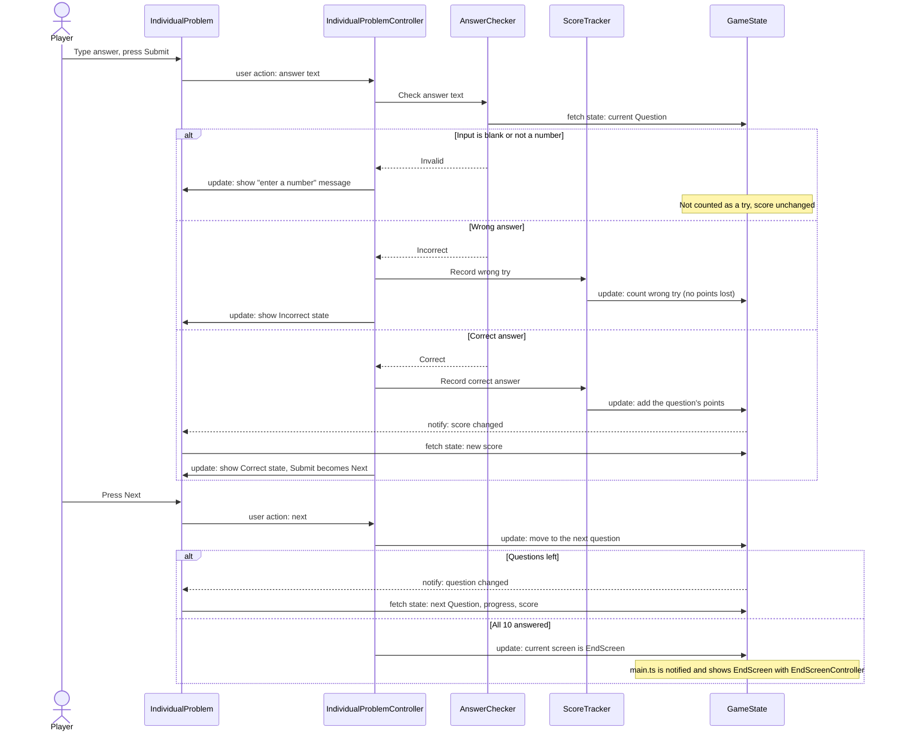
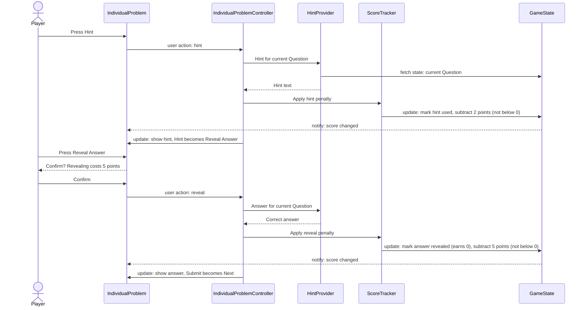

# Architecture

This document collects the architecture of the Percentage Trip Game in one versioned
place: the quality attribute scenarios that drive the design, the dynamic and static
views, a glossary of components, and walkthroughs of the two key scenarios.

**Naming rule:** every component name in this document is written exactly as it appears
in the diagrams and in the code (for example `ScoreTracker`, not "Scoring Engine"). If you
rename a component, update the code, both diagrams, the [glossary](#4-component-glossary),
and the Figma module view in the same pull request.

Contents:

1. [Quality attribute scenarios](#1-quality-attribute-scenarios)
2. [Dynamic view (components and connectors)](#2-dynamic-view-components-and-connectors)
3. [Static view (modules)](#3-static-view-modules)
4. [Component glossary](#4-component-glossary)
5. [Walkthroughs of the key scenarios](#5-walkthroughs-of-the-key-scenarios)
6. [Known gaps between design and code](#6-known-gaps-between-design-and-code)

## Overview: Model-View-Controller

The game follows Model-View-Controller (MVC). Both diagrams use the same three parts:

| Part | What it holds | Folders |
|---|---|---|
| **View** | The UI: one screen per page of the game. Screens draw what's in the Model and report user actions. They never change game data. | `src/presentation/` |
| **Controller** | One controller per screen, named `<Screen>Controller`. It turns that screen's user actions into Model updates and tells its screen what to show. | `src/logic/` (files named `*Controller.ts`) |
| **Model** | Game state and rules (questions, answer checking, hints, scoring), plus the backend and its database. | `src/logic/`, `src/data/`, `src/backend/` |

Controllers and Model logic share `src/logic/`. They are told apart by name: every file
ending in `Controller.ts` is a controller, and no Model module imports a controller.

### Design decisions this document relies on

- **Switching screens:** `GameState` records the current screen. A controller changes
  screens by updating it; `main.ts` is notified and shows the matching screen with its
  controller. No controller imports another controller.
- **Wrong answers:** the player can try again as many times as they like, with no
  penalty. `ScoreTracker` counts wrong tries only for the "wrong answers" stat on
  `EndScreen`.
- **Hints and reveals:** a hint costs 2 points and a reveal costs 5 points, each at most
  once per question, and the score never goes below 0. A revealed question earns no points.

---

## 1. Quality attribute scenarios

Our five priority quality attributes are **modifiability, testability, usability,
conceptual integrity, and deployability**. The game's value comes from its question
content, so we must be able to add and change question types easily (modifiability) and
trust that scoring and answer checking are correct (testability). Our players are middle
schoolers using the game without teacher help (usability). Because a small team builds it
over three sprints, the design must stay consistent (conceptual integrity) and ship
reliably (deployability).

> These are the scenarios from our Q1 submission. The only changes are that component
> names now match the diagrams and the code ("Scoring Engine" → `ScoreTracker`, and so on),
> scenario 2 says "wrong-answer counting" instead of "attempt limits" (there is no limit),
> and scenario 4 describes the per-screen controllers.

### Scenario 1: Modifiability (adding a new question type)

| Part | Description |
|---|---|
| **Source** | A developer on the team |
| **Stimulus** | Wants to add a new question template (for example "tip calculation") to the game |
| **Artifact** | `QuestionGenerator` and its `QuestionTemplate` definitions |
| **Environment** | Design time; the rest of the game is complete and working |
| **Response** | The developer adds the new template in the shared `QuestionTemplate` format. No changes are needed in any screen or controller, `AnswerChecker`, `ScoreTracker`, or `HintProvider`. All existing tests still pass. |
| **Response measure** | Completed in under 3 hours of effort, modifying at most one module plus its test file |

*Why it matters:* our vision includes many question types (discounts, tax, tips, reverse
tax), and we expect to keep adding them.

### Scenario 2: Testability (verifying scoring without the UI)

| Part | Description |
|---|---|
| **Source** | A developer or tester |
| **Stimulus** | Wants to verify the scoring rules: points per question, wrong-answer counting, hint and reveal penalties, and the letter-grade mapping |
| **Artifact** | `ScoreTracker` (and the `GameState` it updates) |
| **Environment** | Development, using the automated test suite |
| **Response** | `ScoreTracker` runs in isolation. Tests set inputs directly (question value, attempts, hints used) and observe outputs (points awarded, final score, grade) without the UI, the network, or the random `QuestionGenerator`. |
| **Response measure** | 100% of scoring rules are covered by automated tests, and the full scoring test suite runs in under 30 seconds |

*Why it matters:* wrong scores would undermine the game's feedback, and scoring logic has
many edge cases (for example, the score must not go below zero).

### Scenario 3: Usability (first-time play without help)

| Part | Description |
|---|---|
| **Source** | A middle school student who has never played the game |
| **Stimulus** | Opens the game and wants to start answering questions |
| **Artifact** | `MainMenu` and `IndividualProblem` screens |
| **Environment** | Normal operation, first use, with no instructions from outside the game |
| **Response** | The student starts a game from `MainMenu` and submits a first answer on `IndividualProblem`. If the input is invalid (blank or non-numeric), the screen shows an inline message explaining what to fix, and no attempt is used. |
| **Response measure** | At least 90% of test users reach their first submitted answer within 60 seconds with no outside help, and 100% of invalid inputs produce a visible error message |

*Why it matters:* players are students practicing on their own, and confusion about the
interface gets in the way of learning percentages.

### Scenario 4: Conceptual integrity (one consistent design)

| Part | Description |
|---|---|
| **Source** | A developer adding a new feature (for example the matching mini-game) |
| **Stimulus** | Needs to add a new screen and new game logic during Sprint 2 or later |
| **Artifact** | Overall code structure: the MVC split, module interfaces, and shared UI components |
| **Environment** | Development, mid-project, with multiple developers working in parallel |
| **Response** | The feature follows the existing patterns: the new screen gets its own `<Screen>Controller`, questions are defined with the shared `QuestionTemplate` format, scoring goes through `ScoreTracker`, screens read the Model but only change it through their controller, and screens use the shared UI components and theme. The documented patterns are the only approach for each of these jobs. |
| **Response measure** | Code review finds zero deviations from the documented patterns (checked by a reviewer using the [contributing checklist](../CONTRIBUTING.md)), and 0 duplicated copies of shared components such as buttons or the score display |

*Why it matters:* several teammates build different screens and features, and the game
should feel like one product to players and one design to developers.

### Scenario 5: Deployability (releasing a new version)

| Part | Description |
|---|---|
| **Source** | A developer |
| **Stimulus** | Merges an approved pull request into `main` and wants the new version available to players |
| **Artifact** | Build and deployment pipeline (GitHub Actions **Tests** workflow and hosting) |
| **Environment** | Normal operation, with players possibly using the current version |
| **Response** | Automated tests run on the merge. If they pass, the new version is built and deployed automatically. If they fail, nothing is deployed and the current version stays live. A bad release can be reverted to the previous version. |
| **Response measure** | Deployment completes within 10 minutes of the merge, a failed test run results in 0 deployments, and rollback to the previous version takes under 5 minutes |

*Why it matters:* frequent small releases let us demo working software to the customer
each sprint, and a broken release shouldn't take the game down.

---

## 2. Dynamic view (components and connectors)

The dynamic view shows the running components and how they interact while the game is
played. The diagram source is [`images/cc-view.svg`](images/cc-view.svg); edit that file to
change it.

**Key**

| Symbol | Meaning |
|---|---|
| Box | A component (a running instance of a module of the same name) |
| Bold box | A group of components: View, Controller, Model, or the backend server |
| Dashed bold box | Components that run on the server instead of in the browser |
| Cylinder | The SQLite database |
| ■ Small black square | An interface (port) where a connector attaches |
| Short-dashed arrow | **User action**: a screen reports a click or keypress to its controller |
| Solid arrow | **Update**: a component tells another to change (a controller updating its screen or the Model, or a Model component updating `GameState`) |
| Dotted arrow | **Notify**: the Model tells the View that state changed, so screens redraw |
| Long-dashed arrow | **Fetch state**: a component reads current state, for example a screen reading the score |
| Thick double-headed arrow | **HTTP request / response** between the browser and the server |
| Dash-dot double-headed arrow | **SQL query / result** between the backend and the database |

How to read it:

- Each screen is paired with its own controller. The screen sends user actions to the
  controller, and the controller updates the screen (for example, switching Submit to Next).
- Controllers are the only components that update the Model.
- When `GameState` changes, the Model notifies the View, and screens fetch the new state to
  redraw. Screens never change the Model directly.
- Moving to another screen is an update to `GameState`. `main.ts` (not drawn) is
  notified and shows the new screen with its controller.
- The browser reaches the database only through `ApiClient` and HTTP. `Accounts` and
  `ScoreHolder` run on the server and are the only components that query the database.

---

## 3. Static view (modules)

The module view shows the code modules and which modules use which. Every component in the
dynamic view is an instance of a module here with the same name. Update the Figma
[Module View CSE110](https://www.figma.com/design/QOx6lEtyU4C2QbAcc2jVZ7/Module-View-CSE110)
to match this diagram (see [gaps](#6-known-gaps-between-design-and-code)).

The diagram source is [`images/module-view.svg`](images/module-view.svg); edit that file
to change it. It is laid out like the dynamic view, so each module sits where its
component does.

**Key**

| Symbol | Meaning |
|---|---|
| Box | A module: one file in the code, with the same name |
| Bold box | A layer, with the folder its modules live in |
| Dashed bold box | A layer that runs on the server instead of in the browser |
| Solid arrow A → B | A uses (imports and calls) B. An arrow from a layer means every module in it may use B. |
| Dotted arrow labeled HTTP | A calls B over the network. The only dependency between the browser and the server. |

**What each controller uses**

The diagram draws the controllers' dependencies on the Model as one "uses" arrow. These
are the specific modules behind it:

| Controller | Uses |
|---|---|
| `LoginScreenController` | `LoginScreen`, `ApiClient`, `GameState` |
| `MainMenuController` | `MainMenu`, `QuestionGenerator`, `GameState` |
| `StoryProgressionController` | `StoryProgression`, `GameState` |
| `IndividualProblemController` | `IndividualProblem`, `AnswerChecker`, `HintProvider`, `ScoreTracker`, `GameState` |
| `EndScreenController` | `EndScreen`, `ScoreTracker`, `ApiClient`, `GameState` |
| `AnswerKeyController` | `AnswerKey`, `GameState` |
| `MinigameController` | `Minigame`, `MinigameState` |

**Rules the diagram encodes**

- **Dependencies point downward only:** controllers → screens and Model, and Model logic →
  data. A screen never imports a controller, and the Model never imports a screen or a
  controller, even though controllers also live in `src/logic/`.
- **Controllers don't import each other.** To change screens, a controller updates the
  current screen in `GameState`, and `main.ts` shows it.
- **Each screen has exactly one controller**, named `<Screen>Controller`. The controller
  creates its screen and gives it callbacks (such as `onSubmit`); this is how the user-action
  connector works without the screen importing the controller.
- **Screens only read the Model.** They read and subscribe to `GameState` (or
  `MinigameState`) to redraw. All changes go through a controller.
- **Only `ApiClient` talks to the backend, and only over HTTP.** Browser code never imports
  `src/backend/`, because it uses Node-only APIs such as `node:sqlite`.
- **Data modules have no dependencies on logic**, which keeps them easy to test and share.

---

## 4. Component glossary

One line per component. Names match both diagrams and the code exactly. **Status** says
whether the module exists on `main` yet.

### View: presentation layer (`src/presentation/`)

| Component | Responsibility | Status |
|---|---|---|
| `LoginScreen` | Lets a player enter their name so their scores can be saved. | Planned (no mockup yet) |
| `MainMenu` | Start screen with Start Trip, How to Play, and Mini Game. Also shows How to Play. | Planned |
| `StoryProgression` | Shows the activity choices (beach, shopping, food, theme park) for the next question. | Planned |
| `IndividualProblem` | Question screen: progress, score, grade scale, scenario, answer input, Submit/Next, Hint/Reveal, and feedback messages. | In progress (`IndividualProblem.ts`) |
| `EndScreen` | Shows the final letter grade, percent score, wrong answers, and hints used, with Answer Key and Play Again. | Planned |
| `AnswerKey` | Lists each question with the player's answers and the correct answer. | Planned |
| `Minigame` | Matching game screen: two columns to match, a countdown timer, and win and lose overlays. | Planned |

### Controller layer (`src/logic/`, files named `*Controller.ts`)

| Component | Responsibility | Status |
|---|---|---|
| `LoginScreenController` | Creates or looks up the player through `ApiClient` and stores them in `GameState`. | Planned |
| `MainMenuController` | Starts a new trip (questions from `QuestionGenerator` into `GameState`), or opens How to Play or the mini-game. | Planned |
| `StoryProgressionController` | Records the chosen activity in `GameState` and moves on to the question. | Planned |
| `IndividualProblemController` | Handles Submit, Next, Hint, and Reveal using `AnswerChecker`, `HintProvider`, and `ScoreTracker`, and updates `IndividualProblem`. | In progress as `GameController.ts`; rename |
| `EndScreenController` | Shows the final grade from `ScoreTracker`, saves the score through `ApiClient`, and handles Answer Key and Play Again. | Planned |
| `AnswerKeyController` | Shows the trip's questions and answers from `GameState`, and handles Back. | Planned |
| `MinigameController` | Runs one matching game in `MinigameState`: pairs, selections, timer, and win or lose. | Planned |

### Model: game logic layer (`src/logic/`)

| Component | Responsibility | Status |
|---|---|---|
| `QuestionGenerator` | Builds a trip's 10 questions (4 easy, 3 medium, 3 hard) from templates with new random numbers, and stores them in `GameState`. | Planned |
| `AnswerChecker` | Validates the player's input and decides whether it matches the current question's correct answer. | Planned |
| `HintProvider` | Gives the hint text and the revealed answer for the current question. Penalties are applied by `ScoreTracker`, not here. | Planned |
| `ScoreTracker` | Applies all scoring rules: points per question, hint and reveal penalties, the floor at zero, and the letter grade. | Planned |
| `ApiClient` | The browser's only connection to the backend: sends the player and finished-trip score over HTTP. | Planned |

### Model: data layer (`src/data/`)

| Component | Responsibility | Status |
|---|---|---|
| `QuestionTemplate` | Definition of one kind of question: scenario text, difficulty, number ranges, how to compute the answer, and the hint. | Planned |
| `Question` | One generated question: its text, numbers, correct answer, point value, and hint. | Planned |
| `GameState` | Everything about the current trip: player, current screen, questions, current position, score, wrong tries, and which hints and reveals were used. Notifies screens when it changes. | Planned |
| `MinigameState` | Everything about the current matching game: the pairs, current selection, matches made, and time left. | Planned |

### Model: backend layer (`src/backend/`, runs on the server)

| Component | Responsibility | Status |
|---|---|---|
| `ApiRouter` | HTTP endpoints that receive requests from `ApiClient` and pass them to `Accounts` or `ScoreHolder`. | Planned |
| `Accounts` | Creates and looks up players (name and unique ID). | Planned |
| `ScoreHolder` | Saves and reads players' finished-trip scores. | Planned |
| `Database` | Opens the SQLite database and creates its tables. | Exists as `src/data/database.ts`; should move here |

---

## 5. Walkthroughs of the key scenarios

These walkthroughs trace two scenarios through the components above, using the connector
types from the dynamic view. They show which component does each job and how the design
supports the quality attributes in section 1.

### 5.1 Answering a question

A player types an answer on the question screen and presses **Submit**.

Step by step:

1. **`IndividualProblem`** passes the text in the answer box to its controller. The screen
   does no math and no checking.
2. **`IndividualProblemController`** asks **`AnswerChecker`**, which compares the text with
   the current `Question`'s correct answer in `GameState`.
3. If the input is blank or not a number, `AnswerChecker` reports it as invalid. The
   controller tells the screen to show an inline message, and **it doesn't count as a try**
   (scenario 3, usability).
4. If the answer is wrong, **`ScoreTracker`** counts the wrong try in `GameState` (for the
   end-screen stats; no points are lost), and the controller shows the Incorrect state so
   the player can try again as many times as they like.
5. If the answer is right, `ScoreTracker` adds the question's points to **`GameState`**.
   `GameState` notifies the screen, which fetches and shows the new score. The controller
   switches the screen to the Correct state, and Submit becomes Next.
6. **Next** moves `GameState` to the following question, and the screen redraws from the
   new state. After question 10, the controller sets the current screen in `GameState` to
   `EndScreen`, and `main.ts` shows it.

How the design supports the quality attributes:

- **Testability (scenario 2):** `AnswerChecker` and `ScoreTracker` don't depend on any
  screen, controller, network call, or random numbers. Tests build a `GameState` with a
  fixed `Question`, call them, and check the result.
- **Conceptual integrity (scenario 4):** each job has exactly one home: checking in
  `AnswerChecker`, scoring in `ScoreTracker`, state in `GameState`, screen changes in the
  controller. The screen only displays.
- **Modifiability (scenario 1):** `AnswerChecker` compares against the `Question`'s stored
  answer, so a new question type needs no changes here.

### 5.2 Using a hint, then revealing the answer

A player is stuck, presses **Hint**, and later presses **Reveal Answer**.

Step by step:

1. **Hint:** `IndividualProblemController` gets the hint text for the current `Question`
   from **`HintProvider`** and tells **`ScoreTracker`** to apply the hint penalty.
2. `ScoreTracker` marks the hint as used for this question in **`GameState`** and subtracts
   the penalty, never letting the score go below zero. `GameState` notifies the screen, which
   redraws the score.
3. The controller tells `IndividualProblem` to show the hint and turn the Hint button into
   **Reveal Answer**.
4. **Reveal:** the confirmation dialog belongs to `IndividualProblem` alone, so cancelling
   changes nothing. On confirm, the controller gets the answer from `HintProvider`, and
   `ScoreTracker` applies the reveal penalty.
5. The question is marked as revealed in `GameState` and earns no points. The mark also
   lets it show correctly on `EndScreen`
   (hints used) and `AnswerKey`. Submit becomes Next.
6. **Penalties apply once per question.** If the player presses Hint or Reveal again, or
   the event fires twice, `ScoreTracker` sees the flag in `GameState` and does not subtract
   again.

How the design supports the quality attributes:

- **Testability (scenario 2):** the "once per question" and "not below zero" rules live in
  `ScoreTracker` and are tested without the UI by calling it twice and checking the score.
- **Modifiability (scenario 1):** hint text comes from the `Question` (and its
  `QuestionTemplate`), so a new question type brings its own hint without changes to
  `HintProvider`.
- **Separation of concerns:** `HintProvider` only provides content and `ScoreTracker` only
  scores, so changing a penalty amount touches one module.

---

## 6. Known gaps between design and code

The definition of done for this document is that component names match across the
scenarios, the diagrams, and the code. These are the places where they don't yet. Fix each
in its own PR and remove it from this list.

| Gap | Where | Suggested fix |
|---|---|---|
| The Figma module view still shows a single `GameController`, has no `HintProvider` or `MinigameState`, and puts no database module in the backend. | Figma Module View | Redraw it to match section 3. |
| `src/logic/GameController.ts` is the old single controller. | `src/logic/` | Rename it to `src/logic/IndividualProblemController.ts`. Its `getCurrentQuestion` belongs to `GameState`. |
| `IndividualProblem.ts` imports from `GameController`, so the screen depends on the controller. | `src/presentation/IndividualProblem.ts` | Have the controller create the screen and pass callbacks (`onSubmit`, `onHint`, `onNext`) instead. |
| The SQLite code is in `src/data/database.ts`, but `Database` is a backend module. Browser code imports from `src/data/`, and this file is Node-only. | `src/data/database.ts` | Move it to `src/backend/Database.ts`. |
| The README's project structure lists `GameController` in `src/logic/`. | `README.md` | List the per-screen controllers instead. |
| `main.ts` always draws the question screen. | `src/main.ts` | Show whichever screen `GameState` says is current, and switch when notified. |
| The decisions at the top of this document (screen switching, wrong answers, hints and reveals) aren't recorded in `docs/decisions.md`, which doesn't exist yet. | `docs/decisions.md` | Create it and record them there. |
| Scenario 5 requires automatic deployment and rollback, but CI only runs tests and the build. Nothing is deployed. | `.github/workflows/tests.yml` | Add a deploy step (for example GitHub Pages for the frontend) or narrow the scenario. |
| The scoring rules use "−2%" for a hint and "5 points" for a reveal. With a score out of 100 these are the same unit, but the docs should use one. | Figma, notes, this document | Use "points" everywhere. |